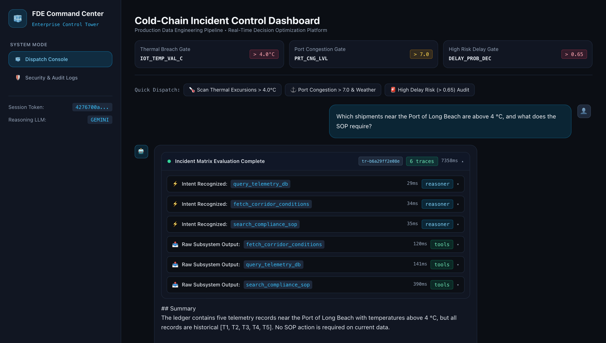
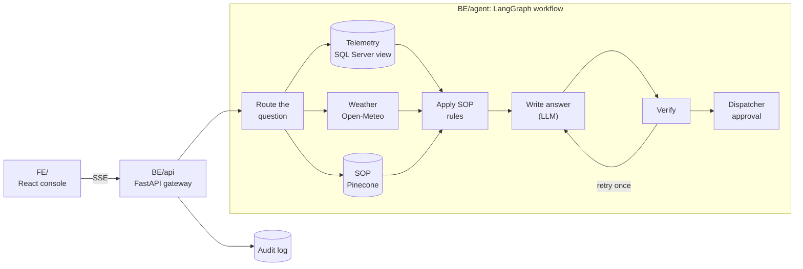
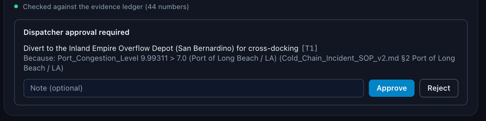

<a id="readme-top"></a>

<!-- PROJECT SHIELDS -->
[![CI][ci-shield]][ci-url]
[![Issues][issues-shield]][issues-url]
[![Python][python-shield]][python-url]
[![LinkedIn][linkedin-shield]][linkedin-url]

<br />
<div align="center">
  <h1 align="center">Cold-Chain Logistics AI Assistant</h1>

  <p align="center">
    A natural-language control tower for refrigerated freight. Ask a question and get a cited answer,
    checked against telemetry, weather and the operating procedure.
    <br />
    <a href="#documentation"><strong>Explore the docs »</strong></a>
    <br />
    <br />
    <a href="https://github.com/jimaaa17/cold-chain-logistics-AI-assistant/issues/new?labels=bug">Report Bug</a>
    &middot;
    <a href="https://github.com/jimaaa17/cold-chain-logistics-AI-assistant/issues/new?labels=enhancement">Request Feature</a>
  </p>
</div>

<details>
  <summary>Table of Contents</summary>
  <ol>
    <li>
      <a href="#about-the-project">About The Project</a>
      <ul>
        <li><a href="#built-with">Built With</a></li>
      </ul>
    </li>
    <li><a href="#architecture">Architecture</a></li>
    <li>
      <a href="#getting-started">Getting Started</a>
      <ul>
        <li><a href="#prerequisites">Prerequisites</a></li>
        <li><a href="#installation">Installation</a></li>
        <li><a href="#configuration">Configuration</a></li>
      </ul>
    </li>
    <li><a href="#usage">Usage</a></li>
    <li><a href="#security-model">Security Model</a></li>
    <li><a href="#testing-and-deployment">Testing and Deployment</a></li>
    <li><a href="#documentation">Documentation</a></li>
    <li><a href="#roadmap">Roadmap</a></li>
    <li><a href="#contributing">Contributing</a></li>
    <li><a href="#license">License</a></li>
    <li><a href="#contact">Contact</a></li>
    <li><a href="#acknowledgments">Acknowledgments</a></li>
  </ol>
</details>

## About The Project



When a refrigerated shipment runs warm, a dispatcher has to combine sensor readings, local conditions
and the operating procedure (SOP) before acting. This project answers that kind of question in one
place. A LangGraph agent queries fleet telemetry in SQL Server, live weather from Open-Meteo and the
SOP in Pinecone, then writes an answer that cites each source.

The language model explains; code controls what it may recommend:

* **Cited evidence.** Each reading, forecast and SOP passage gets an ID such as `[T1]`, and answers cite those IDs.
* **SOP rules in code.** By default, thresholds are evaluated in Python, not by the model.
* **A verifier.** Numbers, citations and recommended actions are checked before the answer is final. A failed draft is rewritten once, then labelled unverified.
* **Human approval.** High-stakes actions, such as diverting freight, pause for a dispatcher's decision.
* **Audit trail.** The prompt, tool calls, checks and decisions are written to a SQL table the agent can only insert into.

> **The data is historical and the SOP is fictional.** Telemetry comes from a public Kaggle dataset
> covering January 2021 to August 2024. This is not a live fleet feed. The SOP in `data/policy/` was
> written for this project, including its "Internal Operations Only" label.

<p align="right">(<a href="#readme-top">back to top</a>)</p>

### Built With

* [![LangGraph][LangGraph]][LangGraph-url]
* [![FastAPI][FastAPI]][FastAPI-url]
* [![React][React.js]][React-url]
* [![Vite][Vite]][Vite-url]
* [![Tailwind][Tailwind]][Tailwind-url]
* [![SQL Server][MSSQL]][MSSQL-url]
* [![Pinecone][Pinecone]][Pinecone-url]
* [![Gemini][Gemini]][Gemini-url]

OpenAI and Ollama models are supported in place of Gemini. SOP embeddings use BGE-M3 locally, or OpenAI.

<p align="right">(<a href="#readme-top">back to top</a>)</p>

## Architecture



| Question type | What happens |
|---|---|
| Incident scan ("which shipments near Long Beach are above 4 °C?") | Telemetry, weather and SOP are fetched in parallel, with no planning call |
| SOP lookup ("when do we escalate to Tier 2?") | Only the SOP is searched |
| Open question ("average temperature by risk class?") | The model plans which tools to call |
| Out of scope or too vague | The assistant asks for clarification and calls no tools |

If a source is unavailable, the answer reports the gap instead of filling it in.

```
BE/
├── agent/           LangGraph dispatch workflow, tools and prompts
├── api/             FastAPI gateway (SSE)
├── rag/             SOP ingestion and retrieval
├── legacy_ingest/   Telemetry CSV → SQL Server loader
├── observability/   Audit and tracing exporters
└── sql/             Read-only view, agent login, audit table
FE/                  React console
data/policy/         SOP documents
tests/               Offline backend tests
src/                 Original Streamlit app (superseded by BE/ and FE/)
```

<p align="right">(<a href="#readme-top">back to top</a>)</p>

## Getting Started

### Prerequisites

* Python 3.12 and Node.js 20
* Docker, for SQL Server
* [ODBC Driver 18 for SQL Server](https://learn.microsoft.com/sql/connect/odbc/download-odbc-driver-for-sql-server)
* API keys for [Pinecone](https://www.pinecone.io/) and [Gemini](https://aistudio.google.com/apikey) (or OpenAI)
* About 5 GB of free disk space if you use the local embedding model

### Installation

Run every command from the repository root. The commands are for macOS and Linux.

1. Clone the repo and install the dependencies.
   ```sh
   git clone https://github.com/jimaaa17/cold-chain-logistics-AI-assistant.git
   cd cold-chain-logistics-AI-assistant
   python3.12 -m venv venv
   source venv/bin/activate
   pip install -r requirements.txt
   npm --prefix FE ci
   ```
2. Create your configuration, then fill in the API keys and choose a strong `SQL_ADMIN_PASSWORD`.
   Use mixed case and digits; avoid `#`, quotes and backslashes. Leave `SQL_AGENT_PASSWORD` empty for now.
   ```sh
   cp .env.example .env
   ```
3. Start SQL Server with the password you set as `SQL_ADMIN_PASSWORD`.
   ```sh
   docker run -e ACCEPT_EULA=Y -e MSSQL_SA_PASSWORD='<admin-password>' \
     -p 127.0.0.1:1433:1433 -v mssql_data:/var/opt/mssql \
     --name legacy-mssql -d mcr.microsoft.com/mssql/server:2022-latest
   ```
   Apple Silicon Macs run this image under emulation, and Docker prints a platform warning.
4. Download the [Kaggle dataset](https://www.kaggle.com/datasets/datasetengineer/logistics-and-supply-chain-dataset),
   save it as `data/raw/dynamic_supply_chain_logistics_dataset.csv`, and load it. Expect 32,065 rows.
   ```sh
   python -m legacy_ingest
   ```
5. Create the read-only view, the agent login and the audit table. Then set the agent's password,
   which the second command generates and saves to `.env`.
   ```sh
   docker exec -i legacy-mssql /opt/mssql-tools18/bin/sqlcmd \
     -S localhost -U sa -P '<admin-password>' -C -b -i /dev/stdin < BE/sql/setup_security_view.sql
   python scripts/rotate_agent_password.py --yes
   ```
   If your editor loads `.env` into its terminal, open a new terminal so the new password is used.
6. Index the SOP in Pinecone. The first run creates the index and downloads the embedding model.
   ```sh
   python -m rag.ingestion
   ```
7. Check the agent's configuration.
   ```sh
   python -m agent --dry-run
   ```
8. Start the API and the console in two terminals, then open <http://localhost:5173>.
   ```sh
   uvicorn api.server:app --host 127.0.0.1 --port 8000
   ```
   ```sh
   npm --prefix FE run dev
   ```

<p align="right">(<a href="#readme-top">back to top</a>)</p>

### Configuration

| Variable | Purpose |
|---|---|
| `SQL_SERVER_HOST`, `SQL_SERVER_PORT` | SQL Server address |
| `SQL_ADMIN_USER`, `SQL_ADMIN_PASSWORD` | Loading data and reading the audit log |
| `SQL_AGENT_USER`, `SQL_AGENT_PASSWORD` | The agent's read-only login |
| `AGENT_LLM` | `GEMINI`, `OPENAI` or `OLLAMA` |
| `GEMINI_API_KEY` or `OPENAI_API_KEY` | Key for the chosen provider |
| `PINECONE_API_KEY` | SOP index |
| `EMBEDDINGS_PROVIDER` | `LOCAL` or `OPENAI` |

Optional settings are in [.env.example](.env.example). Two integrations need an extra package:
`pip install langchain-ollama` for Ollama and `pip install langfuse` for Langfuse tracing.

<p align="right">(<a href="#readme-top">back to top</a>)</p>

## Usage

Type a question in the console, or use one of its three quick prompts: thermal excursions, port
congestion with weather, or high delay risk. You can also ask from the command line:

```sh
python -m agent --prompt "Which shipments near the Port of Long Beach are above 4 °C, and what does the SOP require?"
```

Or call the API, which streams each step as server-sent events:

```sh
curl -N http://127.0.0.1:8000/api/v1/dispatch/stream \
  -H 'Content-Type: application/json' \
  -d '{"session_id": "demo", "prompt": "When does the SOP require escalation to the Tier 2 Logistics Manager?"}'
```

### Working with historical data

Only readings from the last 24 hours can trigger SOP actions. Everything in the dataset is older, so
by default breaches are reported as `historical` and no action is recommended. This is intended:
the assistant doesn't act on old readings.

To demonstrate actions and approvals, widen the window for one run of the API:

```sh
EVIDENCE_FRESHNESS_HOURS=60000 uvicorn api.server:app --host 127.0.0.1 --port 8000
```

The same readings are then labelled `fresh`, and a diversion waits for approval. Use this for
demonstrations only.



_Demonstration on historical data with the widened window._

<p align="right">(<a href="#readme-top">back to top</a>)</p>

## Security Model

* The agent's SQL login can only read one view and insert into the audit table. It can't read the raw table.
* Each query is also checked in code: one `SELECT`, on that view only, with a row limit.
* Reading the audit log requires the administrator's SQL credentials.
* Keys and passwords stay on the server. The browser holds no LLM or database keys.

> **The API has no authentication.** Anyone who can reach it can ask questions and approve actions, and
> the approver's name is whatever the client sends. Keep it on localhost or behind an authenticated proxy.

<p align="right">(<a href="#readme-top">back to top</a>)</p>

## Testing and Deployment

The tests run offline and need no keys or database.

```sh
python -m unittest discover -s tests -v
npm --prefix FE test
npm --prefix FE run build
```

GitHub Actions runs the backend tests, then the frontend tests and build, on pull requests and pushes
to `main`. **Merging to `main` deploys to EC2** when the checks pass. A restart drops in-memory
sessions, including pending approvals. A green run doesn't prove the services restarted, so check
`/healthz` afterwards.

<p align="right">(<a href="#readme-top">back to top</a>)</p>

## Documentation

| Document | Contents |
|---|---|
| [Technical Design Document](materials/Technical%20Design%20Document%20%28TDD%29_%20Cold-Chain%20Logistics%20AI-Assistant.pdf) | Target design |
| [CLAUDE.md](CLAUDE.md) | Detailed developer reference: packages, commands and conventions |
| [BE/AGENTS.md](BE/AGENTS.md), [FE/AGENTS.md](FE/AGENTS.md) | Rules for backend and frontend changes |
| [FE/DESIGN.md](FE/DESIGN.md) | Console design system |
| [Cold-chain SOP](data/policy/Cold_Chain_Incident_SOP_v2.md) | The fictional procedure the agent cites |

<p align="right">(<a href="#readme-top">back to top</a>)</p>

## Roadmap

- [x] Dispatch workflow with coded SOP rules, verification and approval
- [x] Insert-only audit log for the agent
- [ ] API authentication and verified approver identity
- [ ] Render Markdown answers in the console
- [ ] ETA-delay data, so the SOP's cold-storage diversion can be recommended
- [ ] Split `BE/api/server.py` into smaller modules
- [ ] Retire the Streamlit app in `src/`

See the [open issues](https://github.com/jimaaa17/cold-chain-logistics-AI-assistant/issues) for known problems and proposals.

<p align="right">(<a href="#readme-top">back to top</a>)</p>

## Contributing

Bug reports and suggestions are welcome as issues. Because the code isn't licensed for reuse, please
open an issue before preparing a pull request. Agreed changes should:

1. Start from a branch off `main` and follow [BE/AGENTS.md](BE/AGENTS.md) or [FE/AGENTS.md](FE/AGENTS.md).
2. Keep the tests offline and passing.
3. Target `main` in a pull request.

<p align="right">(<a href="#readme-top">back to top</a>)</p>

## License

Copyright © 2026 Jimit Naik. All rights reserved.

This repository is public for viewing. No license is granted to use, copy, modify or distribute the
code. Third-party packages and data keep their own licenses.

<p align="right">(<a href="#readme-top">back to top</a>)</p>

## Contact

Jimit Naik: [GitHub](https://github.com/jimaaa17) &middot; [LinkedIn](https://www.linkedin.com/in/jimitnaik/)

Project link: <https://github.com/jimaaa17/cold-chain-logistics-AI-assistant>

<p align="right">(<a href="#readme-top">back to top</a>)</p>

## Acknowledgments

* [Logistics and Supply Chain Dataset](https://www.kaggle.com/datasets/datasetengineer/logistics-and-supply-chain-dataset) on Kaggle
* [Open-Meteo](https://open-meteo.com/) for weather data
* [BGE-M3](https://huggingface.co/BAAI/bge-m3) embeddings
* [Best-README-Template](https://github.com/othneildrew/Best-README-Template)

<p align="right">(<a href="#readme-top">back to top</a>)</p>

<!-- MARKDOWN LINKS & IMAGES -->
[ci-shield]: https://img.shields.io/github/actions/workflow/status/jimaaa17/cold-chain-logistics-AI-assistant/deploy.yml?branch=main&style=for-the-badge&label=CI%20%26%20deploy
[ci-url]: https://github.com/jimaaa17/cold-chain-logistics-AI-assistant/actions/workflows/deploy.yml
[issues-shield]: https://img.shields.io/github/issues/jimaaa17/cold-chain-logistics-AI-assistant.svg?style=for-the-badge
[issues-url]: https://github.com/jimaaa17/cold-chain-logistics-AI-assistant/issues
[python-shield]: https://img.shields.io/badge/Python-3.12-3776AB?style=for-the-badge&logo=python&logoColor=white
[python-url]: https://www.python.org/
[linkedin-shield]: https://img.shields.io/badge/-LinkedIn-black.svg?style=for-the-badge&logo=linkedin&colorB=555
[linkedin-url]: https://www.linkedin.com/in/jimitnaik/
[LangGraph]: https://img.shields.io/badge/LangGraph-1C3C3C?style=for-the-badge&logo=langgraph&logoColor=white
[LangGraph-url]: https://www.langchain.com/langgraph
[FastAPI]: https://img.shields.io/badge/FastAPI-009688?style=for-the-badge&logo=fastapi&logoColor=white
[FastAPI-url]: https://fastapi.tiangolo.com/
[React.js]: https://img.shields.io/badge/React_18-20232A?style=for-the-badge&logo=react&logoColor=61DAFB
[React-url]: https://react.dev/
[Vite]: https://img.shields.io/badge/Vite_6-646CFF?style=for-the-badge&logo=vite&logoColor=white
[Vite-url]: https://vite.dev/
[Tailwind]: https://img.shields.io/badge/Tailwind_3-06B6D4?style=for-the-badge&logo=tailwindcss&logoColor=white
[Tailwind-url]: https://tailwindcss.com/
[MSSQL]: https://img.shields.io/badge/SQL_Server_2022-CC2927?style=for-the-badge
[MSSQL-url]: https://www.microsoft.com/sql-server
[Pinecone]: https://img.shields.io/badge/Pinecone-000000?style=for-the-badge
[Pinecone-url]: https://www.pinecone.io/
[Gemini]: https://img.shields.io/badge/Gemini-8E75B2?style=for-the-badge&logo=googlegemini&logoColor=white
[Gemini-url]: https://ai.google.dev/
